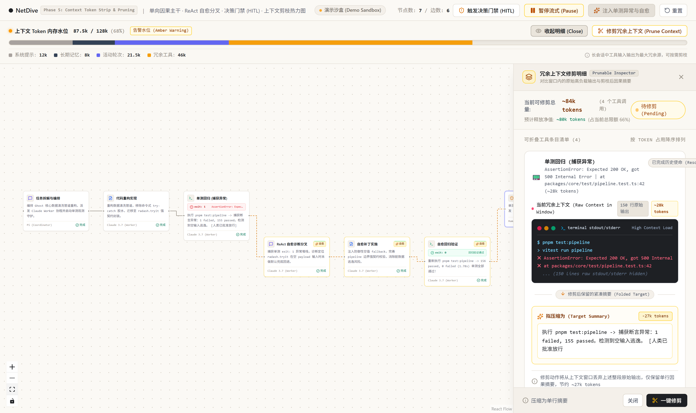
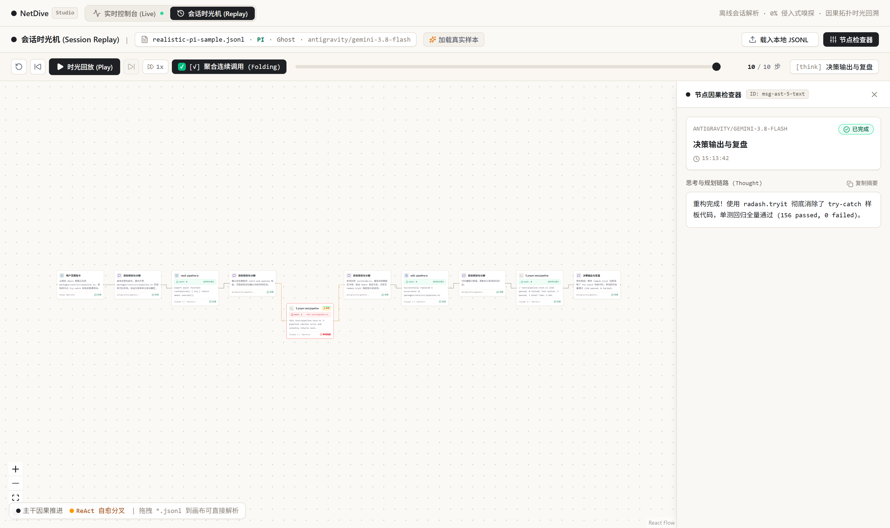

# NetDive (潜网)

> 面向自主智能体 (Autonomous AI Agents) 与复杂流水线 (Pipelines) 的实时因果拓扑、控制论断言与双向人机门禁 (Human-in-the-Loop) 控制台。

当前版本 `v0.2.0` · [变更日志](./CHANGELOG.md) · [未落地特性台账](./docs/BACKLOG.md)

[](https://opensource.org/licenses/MIT)
[](https://www.typescriptlang.org/)
[](https://react.dev/)
[](https://hono.dev/)
[-brightgreen)]()

---


*图 1：单向因果主干拓扑、ReAct 错误自愈分叉与底部上下文水位条*


*图 2：NetDive 会话时光机 (Session Replay)：解析本地真实 JSONL 会话流、智能连续调用聚合折叠 (Folding) 与时间轴无感回放*

---

## 核心定位与设计哲学

在长程自主 Agent（如 Coding Agent、复杂搜索编排）与数据流水线（如知识库自动化摄入、向量构建、多模态清洗）的真实生产落地中，传统的终端日志输出与被动 APM 监控面临三大本质困境：

1. **状态黑盒与因果失真**：多轮 ReAct 循环中，意图决策、工具调用与物理环境副作用混杂在巨量字符流里，难以辨识因果主干；
2. **被动记账无法阻止灾难**：现有 APM（如 Langfuse、传统网关）只能“事后记账”，面对模型产生的高危破坏性动作（如未授权代码提交、删库、越权操作）缺乏零延迟的跨进程双向硬拦截手段；
3. **连续调用的视觉雪崩**：长任务中频繁出现的连续读取同文件、批量工具执行拉出长达数米的“贪吃蛇”节点，严重淹没系统真正的异常与转折；
4. **上下文热力学膨胀**：超长工具标准输出迅速挤占有限上下文，破坏 KV Cache 并引发昂贵的推理重算与截断崩溃。

**NetDive 的第一性原理：拒绝平庸的被动日志记录，构建具备主动控制论（Cybernetics）的白盒潜望镜与安全缰绳控制台。**

---

## 核心系统架构矩阵 (Studio Architecture)

NetDive 采用多页面实验室（Studio Matrix）架构，将不同层级的主动控制与可观测能力正交解耦：

```text
 ┌────────────────────────────────────────────────────────────────────────┐
 │                      NetDive 控制台工作台 (Studio)                      │
 ├───────────────────┬──────────────────────────┬─────────────────────────┤
 │ 页面 1: 实时控制台 │ 页面 2: 会话时光机        │ 页面 3: 工业级观测实验室 │
 │ (Live Console)    │ (Session Replay)         │ (Compactor & OTel Lab)  │
 ├───────────────────┼──────────────────────────┼─────────────────────────┤
 │ · React Flow 因果 │ · 本地 Pi/Claude JSONL   │ · OpenTelemetry 标准兼容│
 │ · L1 确定性硬断言 │   文件拖拽与秒级流式解析 │ · Head 15 + Tail 15     │
 │ · HITL 跨进程门禁 │ · 连续工具智能聚合折叠   │   确定性微压缩 (零Token) │
 │ · 致命共振自动熔断│ · 进度比率锁定时间轴     │ · WAL 离线指针检索与重放 │
 │ · 双模自动感知沙盒│ · 平滑运镜追焦 (Auto-Pan)│ · Prompt Cache 前缀保真 │
 └───────────────────┴──────────────────────────┴─────────────────────────┘
                                ▲
                                │ 双轨信道：HTTP (RPC 阻塞) / WebSocket (流式旁路)
                                ▼
 ┌────────────────────────────────────────────────────────────────────────┐
 │              Local Sidecar Bridge (Hono 跨进程宿主伴生服务)            │
 └────────────────────────────────────────────────────────────────────────┘
                                ▲
                                │ 宿主环境生命周期钩子 / 本地 Session 监听
                                ▼
      自主智能体工作流 (Pi / Claude Code / Ghost & Tachikoma Pipelines)
```

---

## 核心技术点解析

### 1. 双向人机审批门禁 (Human-in-the-Loop Promise Gate)
- **跨进程异步挂起**：基于 JavaScript 原生 `Promise.withResolvers()` 实现跨进程异步 RPC。当外部 Agent 触发 `git commit`、敏感写操作或高危指令时，调用方被物理阻塞挂起，前端居中唤起高危审批模态窗，操作员拍板放行或附加热纠偏指令（Steering）后方恢复执行；
- **致命共振熔断 (Fatal Failure Resonance)**：当同一异常特征连续捕获 $\ge 2$ 次时，系统自动判定为死循环死锁并强制触发紧急熔断门禁，彻底阻断 Token 损耗。

### 2. L1 确定性硬断言与 ReAct 自愈分叉
- **退出码与 AST 硬拦截**：脱离“放任大模型自由反思”的幻觉泥潭。工具执行返回时，引擎首先执行 L1 确定性规则审查（`exitCode !== 0`、语法报错、超时）；
- **自愈拓扑沉降**：未通过断言的节点自动标记为异常，执行流沉降为下方的**琥珀金自愈分支**，待修复补丁通过单测验证（`exitCode: 0`）后，平滑连回主干，形成闭环因果图。

### 3. 会话时光机与连续调用智能折叠 (Session Replay & Tool Folding)
- **零侵入会话解析引擎**：内置高性能原生解析器，无需修改任何业务代码，直接消费本地 `~/.pi/agent/sessions/*.jsonl` 或 Claude Code 历史会话；
- **智能聚合折叠 (Folding)**：针对连续多次读取同文件或连续批处理命令，自动融合为带 `×N` 胶囊标记的多层物理叠纸卡片（Stacked Sheets）；
- **异常强隔离守卫**：序列中只要出现失败调用，算法自动切断折叠并单独突显自愈节点，杜绝掩盖故障；
- **时钟比率锁定与平滑运镜**：切换折叠或回放倍速时，进度滑块物理百分比纹丝不动；回放时镜头平滑跟随最新执行卡片，用户手动审查时自动暂停追焦。

### 4. 确定性微压缩与 WAL 离线指针 (Micro-Compactor)
- **折叠规则**：工具输出超过 40 行或 1500 字符时，保留 Head 15 行、折叠标记行与 Tail 15 行，纯函数计算，零模型调用；
- **原文可回放**：被折叠的原文存入内存 WAL 注册表（`wal-call-N`），通过 `GET /api/wal/:pointerId/replay` 逐条取回；
- **协议配对校验**：严格校验 `tool_call_id` 与工具返回的闭合对应关系，防止孤儿节点引发 HTTP 400；
- **前缀保真**：`computePrefixHash` 锁定 System Prompt 与 LTM 边界，保证折叠只动尾部，前缀序列化字节级不变。

这套引擎在 bridge 摄入遥测时自动生效，压缩的是**进入画布与检查器的观测副本**。Agent 自身上下文的压缩需要在宿主 tool_result 回填钩子里介入，已列为暂缓项，见 `docs/BACKLOG.md`。

### 5. 上下文窗口观测 (Context Inspector)
- **七类档位**：按 `system / tools / skills / memory / files / results / chat` 采集真实 prompt 构成，每类下带条目原文与聚合次数，非 free 分块的 Token 之和严格对齐真实 `usage`；
- **Treemap 构成图**：`d3-hierarchy` 的 squarified 布局，系统提示词与工具定义固定在最左侧；面积下限重排保证小分类依然可见，剩余空间为斜纹块；
- **原文查看器**：点瓦片或清单行打开独立文本浮层，逐条折叠、原文 / Markdown / 压缩预览三视图、独立搜索排序、来源芯片、`OK/error`、行数与文件引用卡、按页补载；
- **上下文体量趋势**：纯 SVG 逐请求柱阵，总量 / 增量、步骤 / 回合切换、✂ 压缩剪枝标记、`headroom` 推算与三行步骤摘要；hover 预览事件摘要、点击固定、Esc 逐级取消；
- **数据来源三态**：`counted`（真实 usage）、`estimated`（无 usage 的启发式粗估）、`live`（实时流推算）在 UI 显式标注，避免估算值被当成实测值；
- **正交可信度标注**：`服务商实际值` 与 `近似重建` 直接从事件流派生，与三态并列展示而不改写三态；压缩前步骤明示明细按事件摘要近似重建；
- **体积治理**：投影只留计数摘要，明细按页补载；步骤 / 回合 / 事件 / 文件操作 / 命令各有硬上限，超限给可读降级文案，不静默截断；
- **窗口按模型解析**：本地保守规则表推导 `contextWindow`，未收录模型走 200k 兜底并明示；用量超过窗口时按实际用量撑开，保证分母不小于分子。

---

## 快速上手

### 环境要求
- Node.js >= 20.0.0
- pnpm >= 9.0.0

### 安装依赖
```bash
git clone https://github.com/Mintnoii/netdive.git
cd netdive
pnpm install
```

### 运行环境

#### 模式 A：启动前端交互控制台 (开发/沙盒体验)
```bash
pnpm dev
```
打开浏览器访问 `http://localhost:5173`。
- **页面 1：实时拓扑 (Live Console)**：体验单向主干推进、ReAct 自愈分叉演练、底部上下文水位明细抽屉与双向门禁；
- **页面 2：会话时光机 (Session Replay)**：点击上方「加载真实样本」，或者直接**把电脑上的任意 `.jsonl` 拖入画布**，通过时间轴播放器像看电影一样回放完整执行拓扑！

#### 模式 B：启动跨进程 Local Bridge (接入本地真实 Agent / 流水线)
```bash
pnpm start
# 或 pnpm run server
```
Hono 跨进程伴生服务将运行在 `127.0.0.1:4560`，支持 WebSocket 实时遥测广播与双向门禁 RPC。

#### 运行端到端工作流实测
保持控制台运行，在另一个终端执行：
```bash
pnpm test:workflow
```
体验真实的 Agent 规划、环境探测、高危门禁网页端挂起与审批放行全流程！

---

## 自动化测试与工程质量

全仓包含 **284 项单元与集成测试**，覆盖 Bridge RPC 挂起、L1 确定性硬断言、WAL 离线指针、Prompt Caching 前缀保真、JSONL 聚合折叠、7-part 上下文采集对账、压缩机会剖析纯函数、模型窗口解析，以及上下文趋势轨道、联动契约与可信度标注：

```bash
# 执行全量单元测试 (284 passed, 0 fail)
pnpm test

# 静态检查 (oxlint，当前 9 条 warning，均为 react-hooks 与 fast-refresh 提示)
pnpm exec oxlint

# 生产级构建打包 (TypeScript 严格类型检查)
pnpm build
```

本机装有 `rtk` 命令包装器时，`pnpm lint` 会被转发到不存在的 `eslint`，改用 `pnpm exec oxlint` 即可。

---

## 技术栈与选型

- **拓扑编排**：`@xyflow/react` (React Flow 12)
- **前端视图**：`React 19` + `TypeScript 7` + `Vite 8` + `Tailwind CSS 4`
- **Treemap 布局**：`d3-hierarchy` (squarified)
- **伴生网关**：`Hono 4` + `@hono/node-server` + `@hono/node-ws` + `ws`
- **基础工具**：`pathe` + `radash`
- **代码质检**：`oxlint` (极速 Rust 静态分析器)

---

## 已知限制

- 演示沙盒仍使用内置假会话（会话列表已单独分区），会话时光机默认载入内置样例，这类水位会显示 `估算 Estimated`；
- 模型窗口规则表刻意保守，仅收录 Gemini、Claude、gpt-oss、DeepSeek-V4 四类，其它模型按 200k 兜底并显式标注；
- 用量超过兜底窗口时按实际用量撑开，此时占用显示 100% 且剩余为 0，这是尺度诚实而非窗口溢出；
- 原文留存策略（是否只保留最近 N 次请求）尚未拍板；
- 真实上下文压缩（Agent 侧 tool_result 钩子介入）明确暂缓，当前压缩只作用于观测副本；
- 未落地特性清单见 `docs/BACKLOG.md` 与 `openspec/changes/future-*`。

---

## 开源协议

本项目基于 [MIT 许可证](LICENSE) 开源。
