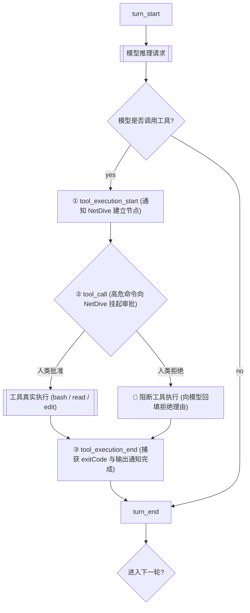

# RFC-20261102: 智能体宿主无感接管 (Zero-Intrusion Host Extension) 全景方案与理论真源

- **方案状态**: 规划与理论固化 (Architectural Blueprint & Theoretical Foundations)
- **核心文件**: `~/.pi/agent/extensions/pi-netdive-bridge.ts` (全局宿主单点插件)
- **统摄目标**: 彻底根除业务代码侵入式打点，通过 Agent 宿主环境生命周期切面实现 $O(1)$ 全机因果拓扑可观测与人在回路 (HITL) 决策门禁。

---

## 一、为什么会有这个方案？（踩坑与痛点根源）

在此前的尝试中，我们在 `Tachikoma` 业务库中实现了一个 `telemetry.ts`，并在抓取与灵感处理函数中层层包裹：
```typescript
// ❌ 侵入式反模式 (Invasive Anti-Pattern)：严重污染业务逻辑
export async function refineAndCreateSpark(db, rawInput, options) {
  const input = await tachikomaReporter.step("distill", () => refine(rawInput), {
    title: "语义提纯与分类", actor: "Tachikoma", gesture: "classify"
  });
  const record = await tachikomaReporter.step("persist", () => create(input), {
    title: "落盘", actor: "SQLite", gesture: "disk"
  });
  return record;
}
```

### 暴露出的三大致命硬伤：
1. **代码恶心感的来源（职责物理边界崩塌）**：
   业务函数本应是纯粹的数据管道（IPO：输入长文，输出解析对象并持久化）。强行塞入遥测参数（`title`、`actor`、`gesture`、`summary`）后，代码充斥着与业务目标无关的展示型胶水。
2. **多项目扩展地狱（$O(N)$ 维护负担）**：
   如果接着接 Ghost，Ghost 的 `pipeline.ts`、`builder.ts`、`validator.ts`、`evict.ts` 每一处都要重复写打点；未来新增任意工具或项目，都要去污染一次业务源码。
3. **接口漂移脆弱性（强耦合）**：
   一旦 NetDive 控制平面的 `TelemetryEvent` 契约需要新增字段，全机所有业务仓库都得跟着改代码并重新发布。

**核心结论：在业务代码内部手搓打点，是方向性的错误！**

---

## 二、方案理论支撑与参考真源 (Theoretical Foundations)

本方案绝非凭空臆造，而是高度立足于**控制论、Ghost 知识库第二大脑既有智慧、以及工业界最新标准**的三重共振：

### 1. Ghost 第二大脑既有理论真源（Prior Art in Ghost）

#### 真源 A：《模型决策与宿主执行权责分离》
- **物理路径**：`Ghost/wiki/learning/模型决策与宿主执行权责分离.md`
- **核心论断**：
  > “大模型本质是只读概率黑盒，无法对物理环境产生真实副作用；宿主环境（Host Runtime）则是具备确定性状态机、I/O 权限与生命周期管控的执行容器……将意图决策收敛于模型，将动作鉴权、副作用执行与环境反馈收敛于宿主。”
- **理论映射**：
  - 业务代码（Tachikoma/Ghost CLI）是运行在操作系统层面的客体；
  - 调起它们的 AI Agent 运行在 **Pi 宿主环境（Harness Runtime）** 中；
  - **控制与可观测性的天然真理源在「宿主」，绝不在「客体业务」！**

#### 真源 B：《智能体运行循环与生命周期拦截》
- **物理路径**：`Ghost/wiki/learning/智能体运行循环与生命周期拦截.md`
- **核心论断**：
  > “架构层严格解耦**参与型拦截**（可变参数、篡改请求或阻断执行的控制平面）与**观察型订阅**（只读广播、日志流推送等遥测数据平面），实现**低侵入的零源码改造二开**。”
- **四象限拦截切面（10 处 Hook）**：
  - 工业级系统从来不在业务代码内部打点，而是在模型调用切面（Pre/Call/Post）和工具执行切面（Pre/Exec/Post）通过外层宿主统一装配。

### 2. 经典控制论：POMDP（部分可观察马尔可夫决策过程）
- 在智能体系统交互中：
  - Agent 是控制器（Controller）；
  - 外部环境是受控对象（Plant）；
  - **传感器（Sensors/Telemetry）与执行器门控（Actuator Gates）必须挂载在控制平面环路（Harness Loop）上**，如果把传感器硬焊在受控对象体内，会导致系统内聚性彻底瓦解。

### 3. 开源社区与工业界标准（Industry Ground Truth）
- **OpenTelemetry for AI Agents (2025/2026 规范)**：
  “Auto-instrumentation for AI Agents must hook into the Agent Framework / Runtime lifecycle, NOT the business tools.”（智能体自动遥测必须钩入 Agent 运行时生命周期，严禁侵入业务工具）。
- **Braintrust & Langfuse 实践**：
  采用宿主代理（Proxy/Hook）拦截模式，业务工具保持为干净的纯 CLI 或标准函数，由外层框架捕获输入参数、执行耗时与退出码。

---

## 三、宿主执行原理：Pi 生命周期切面剖析

根据 Pi 官方核心底层规范（`@earendil-works/pi-coding-agent/docs/extensions.md`），Pi 的运行循环（Agent Loop）拥有极其严密的单向流式切面：



### 关键切面契约：
1. **`tool_execution_start`**：
   - 触发时机：大模型决定调用工具、参数刚刚解析完毕；
   - 携带数据：`toolCallId`、`toolName`、`args`；
   - **NetDive 映射**：立刻发射 `node_start` 事件，前端秒级画出正在流式运行的蓝色/灰色节点卡片。
2. **`tool_call`（参与型控制门禁，最高安全核心）**：
   - 触发时机：工具即将真正落盘或执行前的一毫秒；
   - 核心能力：**支持异步阻塞！若返回 `{ block: true, reason: '...' }`，工具将根本不会在操作系统中执行！**
   - **NetDive 映射**：跨进程向 `http://127.0.0.1:4560/api/gate/prompt` 发起 HTTP 请求，利用 `Promise.withResolvers` 挂起；在 NetDive 网页端点击「批准」，HTTP 200 返回，工具继续执行；若点击「拒绝」，原路截胡，保护本地物理环境。
3. **`tool_execution_end`**：
   - 触发时机：工具在操作系统执行结束，或被门禁阻断；
   - 携带数据：`toolCallId`、`result`、`error`、执行耗时；
   - **NetDive 映射**：发射 `node_complete` 事件，卡片显示绿色通过 `exit: 0` 或红色警告 `exit: 1`，将输出填入抽屉。

---

## 四、全局单点实现：`pi-netdive-bridge.ts` 源码详解

该文件只需放置在全局宿主扩展目录 `~/.pi/agent/extensions/pi-netdive-bridge.ts`，**全机所有工程立刻全自动生效，不需要任何业务项目写一行代码**！

```typescript
/**
 * @file ~/.pi/agent/extensions/pi-netdive-bridge.ts
 * @description NetDive 宿主无感接管扩展 (Zero-Intrusion Host Extension)。
 * 依托 Pi 官方生命周期切面，统摄全机工具调用因果图构建与高危操作 HITL 决策门禁。
 *
 * 核心审美契约：
 * 1. 业务零侵入：Tachikoma、Ghost 及所有外部项目保持 100% 干净，零打点代码；
 * 2. 宿主生命周期拦截：挂载 tool_execution_start, tool_call, tool_execution_end；
 * 3. 严格 Fail-Silent：若 NetDive 控制台未启动，所有网络请求静默吞掉，Pi 执行零阻碍。
 */

import type { ExtensionAPI } from "@earendil-works/pi-coding-agent";
import { tryit } from "radash";

export default function (pi: ExtensionAPI) {
  const NETDIVE_BRIDGE = (process.env.NETDIVE_BRIDGE || "http://127.0.0.1:4560").replace(/\/+$/, "");
  let isBridgeOnline: boolean | null = null;
  let lastProbeTime = 0;

  /**
   * 极速探活 (50ms 窗口，带 10 秒短期缓存，绝不拖慢 Agent 交互)
   */
  async function probeBridge(): Promise<boolean> {
    const now = Date.now();
    if (isBridgeOnline !== null && now - lastProbeTime < 10000) {
      return isBridgeOnline;
    }
    const [err, res] = await tryit(async () => {
      return await fetch(`${NETDIVE_BRIDGE}/health`, {
        method: "GET",
        signal: AbortSignal.timeout(50),
      });
    })();
    isBridgeOnline = !err && Boolean(res?.ok);
    lastProbeTime = now;
    return isBridgeOnline;
  }

  /**
   * 格式化手势分类 (将 Pi 原生工具映射为 NetDive 拓扑手势)
   */
  function mapToolToGesture(toolName: string): "bash" | "edit" | "read" | "tool" {
    if (toolName === "bash") return "bash";
    if (toolName === "edit" || toolName === "write") return "edit";
    if (toolName === "read") return "read";
    return "tool";
  }

  // =========================================================================
  // 1. 切面：工具执行前 (建立拓扑节点)
  // =========================================================================
  pi.on("tool_execution_start", async (event) => {
    const online = await probeBridge();
    if (!online) return;

    const commandText = event.args?.command || event.args?.path || "";
    const shortDesc = commandText ? `: ${String(commandText).slice(0, 45)}` : "";

    await tryit(async () => {
      await fetch(`${NETDIVE_BRIDGE}/api/telemetry`, {
        method: "POST",
        headers: { "Content-Type": "application/json" },
        body: JSON.stringify({
          type: "node_start",
          nodeId: event.toolCallId,
          parentId: event.parentToolCallId || null,
          actor: "Pi (Harness)",
          gesture: mapToolToGesture(event.toolName),
          name: event.toolName,
          title: `${event.toolName}${shortDesc}`,
          timestamp: Date.now(),
          payload: {
            args: event.args,
            toolName: event.toolName,
          },
        }),
      });
    })();
  });

  // =========================================================================
  // 2. 切面：高危命令硬门禁 (HITL 跨进程决策挂起)
  // =========================================================================
  pi.on("tool_call", async (event, ctx) => {
    const online = await probeBridge();
    if (!online) return; // NetDive 离线时，降级放行或由 Pi 终端自带门禁兜底

    const command = String(event.args?.command || "");
    const isGitCommit = /git\s+commit/i.test(command);
    const isDestructiveFs = /rm\s+-[a-zA-Z]*r[a-zA-Z]*f/i.test(command);
    const isWikiPurge = /wiki-evict|wiki-purge/i.test(command);

    // 命中高危断言：向 NetDive 挂起审批
    if (event.toolName === "bash" && (isGitCommit || isDestructiveFs || isWikiPurge)) {
      const [postErr, res] = await tryit(async () => {
        return await fetch(`${NETDIVE_BRIDGE}/api/gate/prompt`, {
          method: "POST",
          headers: { "Content-Type": "application/json" },
          body: JSON.stringify({
            gateId: `gate-${event.toolCallId}`,
            nodeId: event.toolCallId,
            command,
            summary: isGitCommit
              ? "检测到 Git Commit 提交操作，触发 NetDive 全局硬门禁"
              : isDestructiveFs
                ? "检测到破坏性文件删除 (rm -rf)，触发安全熔断"
                : "检测到知识库批量退火下线操作，需要人类在环确认",
            timestamp: Date.now(),
          }),
        });
      })();

      if (postErr || !res?.ok) {
        return; // 桥接异常时放行
      }

      const [jsonErr, body] = await tryit(async () => (await res.json()) as { decision?: "approved" | "rejected"; reason?: string })();
      if (!jsonErr && body?.decision === "rejected") {
        // 🛑 核心拦截点：向 Pi 报告阻断，命令根本不会在 OS 终端跑！
        return {
          block: true,
          reason: body.reason || "人类操作员在 NetDive 控制台拒绝了该高危操作",
        };
      }
    }
  });

  // =========================================================================
  // 3. 切面：工具执行结束 (更新结果与观察工件)
  // =========================================================================
  pi.on("tool_execution_end", async (event) => {
    const online = await probeBridge();
    if (!online) return;

    const hasError = Boolean(event.error);
    const outputString = event.result ? String(event.result) : (event.error?.message || "");
    const outputLines = outputString.split("\n").slice(0, 15); // 提取前 15 行摘要

    await tryit(async () => {
      await fetch(`${NETDIVE_BRIDGE}/api/telemetry`, {
        method: "POST",
        headers: { "Content-Type": "application/json" },
        body: JSON.stringify({
          type: "node_complete",
          nodeId: event.toolCallId,
          parentId: event.parentToolCallId || null,
          actor: "Pi (Harness)",
          gesture: mapToolToGesture(event.toolName),
          name: event.toolName,
          status: hasError ? "failed" : "completed",
          timestamp: Date.now(),
          observation: {
            exitCode: hasError ? 1 : 0,
            output: outputLines,
          },
        }),
      });
    })();
  });
}
```

---

## 五、深入实证：Tachikoma 真实工作流是如何被宿主无感感知、控制与可视化的？

这是整个方案最精妙、也最令人豁然开朗的地方。我们通过**真实微信触发场景**，一步步还原整个数据流与控制流的物理运转全过程：

```text
 ┌────────────────────────────────────────────────────────────────────────┐
 │ 【物理场景】：你在微信给机器人发了一篇文章链接                            │
 │  https://mp.weixin.qq.com/s/xxxx                                       │
 └───────────────────────────────────┬────────────────────────────────────┘
                                     │
                                     ▼
 ┌────────────────────────────────────────────────────────────────────────┐
 │ 阶段 1：智能体意图识别与工具决策 (Agent Loop & Decision)                │
 │  • ClawBot / Pi 接收到输入，根据 skills/tachikoma 决定调用 bash:       │
 │    bash: node apps/cli/src/cli.ts capture "<url>"                      │
 └───────────────────────────────────┬────────────────────────────────────┘
                                     │
                                     ▼ 宿主切面拦截点 1 (尚未真正执行命令！)
 ┌────────────────────────────────────────────────────────────────────────┐
 │ 阶段 2：宿主切面 tool_execution_start 无感感知                         │
 │  • pi-netdive-bridge.ts 捕获到工具启动事件：                            │
 │    event.toolName = 'bash'                                             │
 │    event.args.command = 'node apps/cli/src/cli.ts capture ...'         │
 │  • 【无感语义嗅探 (Semantic Sniffing)】：                             │
 │    宿主单点插件自动识别出命令包含 "tachikoma capture"，无需修改 Tachikoma 源码，
 │    自动将其归纳映射为：                                                 │
 │    {                                                                   │
 │      title: 'Tachikoma: 外部长文捕获',                                 │
 │      gesture: 'fetch',                                                 │
 │      actor: 'Tachikoma (Clipper)'                                      │
 │    }                                                                   │
 │  • 异步发射 node_start ➔ NetDive 控制台画布上立刻弹出流式运行卡片！        │
 └───────────────────────────────────┬────────────────────────────────────┘
                                     │
                                     ▼ 宿主切面拦截点 2 (高危门禁审批)
 ┌────────────────────────────────────────────────────────────────────────┐
 │ 阶段 3：宿主切面 tool_call 跨进程人在回路控制 (HITL Gate)               │
 │  • 若 Agent 紧接着想要执行批量写盘、全库退火或 git commit 等破坏性操作：   │
 │  • tool_call 触发异步拦截，挂起 Promise，向 NetDive 弹出高危红框；       │
 │  • 人类在 NetDive 网页点击【批准】：继续放行；                          │
 │  • 人类点击【拒绝】：返回 { block: true }，OS 终端根本不会执行该命令！   │
 └───────────────────────────────────┬────────────────────────────────────┘
                                     │ 人类批准后，OS 真正执行 bash
                                     ▼
 ┌────────────────────────────────────────────────────────────────────────┐
 │ 阶段 4：Tachikoma 原生脚本在操作系统中纯净运行 (Native Execution)       │
 │  • Tachikoma 代码 100% 干净，没有一行 telemetry.ts！                   │
 │  • 像过去一样平实执行 Fast-HTTP 抓取、正文清洗、RFC-2026 落盘；        │
 │  • 终端打印出真实的执行回执：                                            │
 │    "[Tachikoma] 捕获成功: .../Ghost/_raw/articles/xxx.md (SHA256: ...)" │
 └───────────────────────────────────┬────────────────────────────────────┘
                                     │
                                     ▼ 宿主切面拦截点 3 (执行结果与因果收敛)
 ┌────────────────────────────────────────────────────────────────────────┐
 │ 阶段 5：宿主切面 tool_execution_end 捕获产物与完成可视化                │
 │  • pi-netdive-bridge.ts 捕获到执行结束：                                │
 │    event.error = null                                                  │
 │    event.result = '[Tachikoma] 捕获成功: .../Ghost/_raw/articles/xxx.md'
 │  • 宿主自动发射 node_complete 到 NetDive：                             │
 │    - 节点状态流转为 completed，亮起绿色 ✔ exit: 0；                    │
 │    - 将抓取成功的路径、SHA256、耗时自动提取并灌入 NetDive 卡片正文与右侧抽屉；
 │    - 上下文 Token 水位计自动扣减与累加。                               │
 └────────────────────────────────────────────────────────────────────────┘
```

### 核心物理差异（一目了然）：

1. **谁是执行者？**  
   - 业务代码（Tachikoma）只是普通的命令行工具（CLI），它根本不需要感知 NetDive 的存在，就像 `git`、`ls`、`pnpm test` 不需要知道可观测系统一样；
2. **谁在控制和可视化？**  
   - 是外层的 **Pi 宿主环境**！因为所有命令都是 Agent 在 Pi 的调度下运行的；
   - 宿主在命令发出的前一刻捕获（`tool_execution_start`），在命令运行前决定批不批准（`tool_call`），在命令跑完后拿走结果（`tool_execution_end`）；
3. **为什么能做到 100% 业务无感？**  
   - **Tachikoma 仓库内 0 依赖、0 改动、0 打点代码**；
   - 所有的语义映射（把 `tachikoma capture` 识别为网页抓取，把 `tachikoma spark` 识别为灵感录入）全部收敛在 `~/.pi/agent/extensions/pi-netdive-bridge.ts` 这一个全局插件里！
   - 未来无论是接入 Ghost 炼化，还是接入任何新的业务命令，**只需在全局插件里加一行命令识别规则，业务工程永远保持 100% 的纯粹与优雅！**

---

## 六、方案实施带来的质变对比

| 对比维度 | 旧方案：业务侵入打点 (Invasive Tracing ❌) | 新方案：全局 Pi 宿主无感接管 (Host Extension ✅) |
| :--- | :--- | :--- |
| **业务代码状态** | 极其臃肿恶心，Tachikoma 和 Ghost 里到处散落 `reporter.step` 脏代码 | **100% 绝对纯净**！业务代码一行不改，只专注于自身业务逻辑 |
| **接入成本** | 每个项目都要写一遍 `telemetry.ts`，维护成本 $O(N)$ | **零成本**！只需在全局写一个扩展文件，全机所有项目自动生效 ($O(1)$) |
| **可观测全貌** | 只能看到自己手工打点的那两三个步骤，大模型思考和读文件完全是黑盒 | **上帝视角**！大模型思考（think）、读文件（read）、改代码（edit）、跑命令（bash）全链路自动建图 |
| **门禁拦截层级** | 只能在业务代码内部被动挂起 | **宿主物理硬拦截**！在工具真正执行前一毫秒跨进程截胡，未获批准命令根本不会落盘 |
| **符合审美准则** | 彻底违背 MIND.md 架构审美维度 3（边界污染） | **高度践行 MIND.md 架构审美**（权责分离、宿主治理、物理边界纯粹） |

---

## 七、落地步骤规划 (Next Steps)

1. **将 `pi-netdive-bridge.ts` 写入全局扩展目录**：
   `C:/Users/wangqing/.pi/agent/extensions/pi-netdive-bridge.ts`；
2. **运行 `sync.ps1` 进行全机注册与探针分发**；
3. **真实场景闭环测试**：
   - 启动 NetDive（`http://localhost:5173`）；
   - 在任意终端（或微信通道）运行任何 AI Agent 任务；
   - 亲眼见证第二屏幕在**零业务代码侵入**的前提下，全景流式自动画出因果拓扑图与高危门禁审批框！
